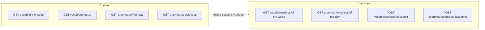
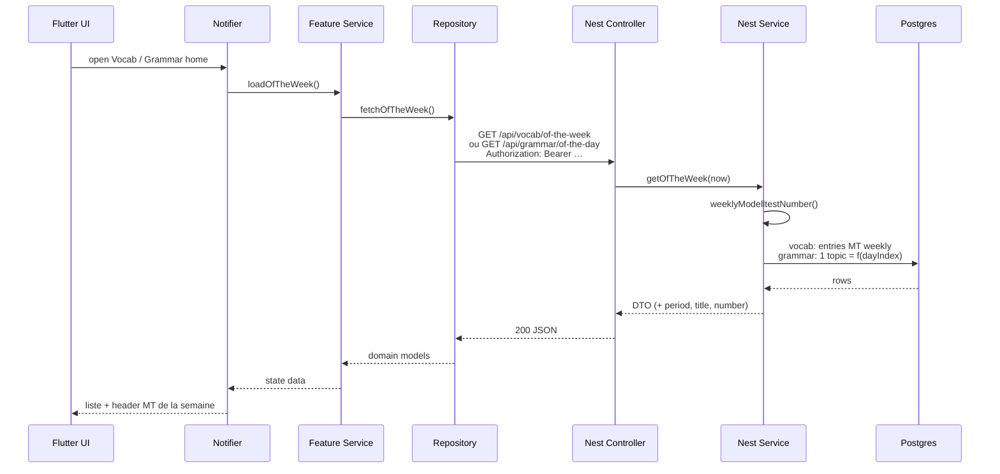
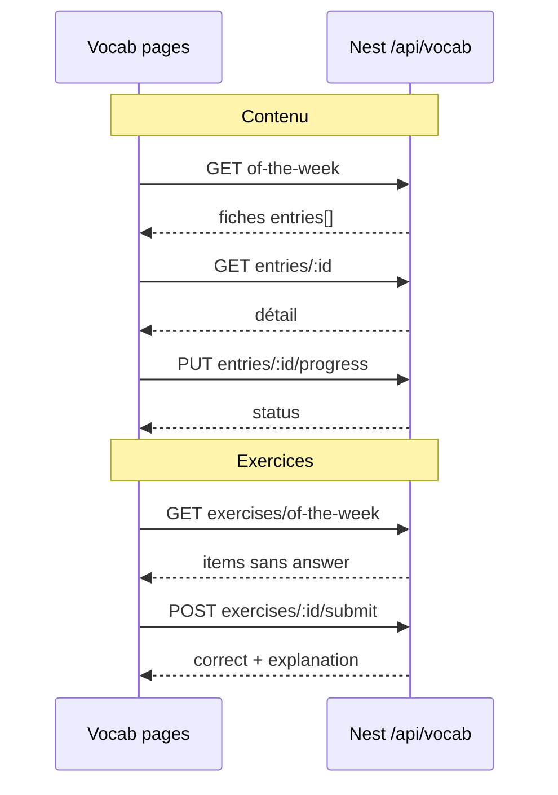

# Spec: Vocabulaire & Grammaire (catalogue DB + APIs d’enrichissement)

Status: **IN PROGRESS — grammar backend done 2026-10-13.** Branche `feat/vocab-grammar`. Vocab FE/BE encore à faire.
Author: drafted 2026-10-13 against branch `fix/listening-training-reissue-url` @ `6c5e167`.

---

## Décision d’architecture (résumé)

| Principe | Règle |
|---|---|
| Source de vérité runtime | **PostgreSQL (Prisma)** — l’app ne lit que notre DB |
| Entrée produit Vocab | **Automatique = Modelltest of the week** (`weeklyModelltestNumber` / période 7j UTC) |
| Entrée produit Grammar | **Automatique = thème of the day** — une leçon / jour, tirée du pack du weekly MT |
| API Nest « directe » | Pas de `modelltest=` ni de `topic=` choisi par l’élève en V1 — résolution serveur |
| **Contenu ≠ Exercices** | Surfaces séparées : apprendre vs pratiquer |
| APIs externes | Import offline uniquement |
| Vocabulaire | Pack **hebdo 100 mots clés** (algo score : MT + réputés ; ≥30 % hors MT) ; 5 natures |
| Grammaire | **1 topic / jour** dans le pool **lié au MT weekly** (pas les 365 globaux) |

Plan détail : `docs/superpowers/plans/2026-10-17-vocab-senses-conjugations-mt-scope.md`.

---

## Assumptions (tranchées 2026-10-13, mises à jour 2026-10-17)

| # | Décision | Notes |
|---|---|---|
| 1 | ✅ **Guests** : vocab + grammar **accessibles** | Auth guest JWT OK |
| 2 | ✅ UX vocab = **of-the-week** ; pas de sélecteur MT / Prep Pass | — |
| 3 | ✅ Pack = **100** (36 subst. / 27 verbes / 17 adj / 10 adv / 10 prep) via algo ; **pas** tout le MT | Toujours ≥30 % hors MT |
| 3b | ✅ Phase offline **analyse MT → extract** candidats avant enrich / pack | `npm run vocab:analyze-extract` |
| 3c | ✅ Multi-sens `VocabSense[]` + conjugaison verbe DE-only en DB | Traduction au niveau des sens |
| 3d | ✅ Search catalogue ; **pas** d’ajout manuel de mots V1 | — |
| 3e | ⏳ Quiz vocab : answers dans GET (ADR 0001) + submit score | Levels helpers prêts ; endpoints HTTP **pas encore** exposés |
| 3f | ⏳ Practice vocab = **3 niveaux** ; Q + chrono = grammar **× 2,5** (arrondi) | Easy 25 Q / 13 min · Medium 38 / 18 · Hard 50 / 25 — helpers `vocab-practice-levels` ; API practice **à venir** |
| 3g | ✅ Vocab `?lang=fr\|en\|de` (défaut `fr`) comme grammar | Champs localisés `meaning` / `exampleGloss` / `note` (+ `lang` sur la réponse) ; `meaningFr`/`meaningEn` conservés |
| 4 | ✅ Grammar = **thème du jour** ; thèmes **peuvent se répéter** | — |
| 4b | ✅ Leçon → exos linéaire ; succès requis pour débloquer | — |
| 4c | ✅ Déblocage exo suivant : **bonne réponse** | `409` si locked |
| 4d | ✅ Pool grammar = **tous les topics publiés** (indépendant du MT) | table `grammar_topic_modelltests` supprimée |
| 5 | ✅ Fiche = lemma(+article)+pos ; **N sens** avec exemple+trad | Remplace glossesFr[] seul |
| 6 | ✅ Catalogue réputé **tous niveaux CEFR** | — |
| 7 | ✅ Localisation fiches : **FR + EN** | Conjugaison = DE only |
| 8 | ✅ Guards : JWT + StudentSubscription ; pas PrepPass | — |
| 9 | ✅ Branche `feat/vocab-grammar` | — |
| 10 | ✅ Hors scope Prep Pass / picker / add « mes mots » | — |

---

## Objective

Ajouter deux features d’entraînement **alignées sur le Modelltest de la semaine** :

1. **Vocabulaire** — mots déjà extraits des textes de ce MT (Lesen, Hören, Sprachbausteine, Schreiben), avec signification, genre, exemple.
2. **Grammaire** — **chaque jour un nouveau thème** (leçon + drills), choisi automatiquement dans les topics liés au Modelltest of the week.

**Success looks like :**
- **Vocab** : ouvre → mots du **MT de la semaine** (pack stable 7 jours), flash / quiz.
- **Grammar** : ouvre → thème du jour (id UUID) → lit la **leçon** → puis enchaîne les **exercices du plus facile au plus dur** ; pas de saut ; retour possible ; demain = autre thème.
- Changement de semaine UTC → nouveau MT → nouveau pool de thèmes grammar.

### API « directe » — ce que ça veut dire

| Couche | Comportement |
|---|---|
| **Flutter** | `GET /api/vocab/of-the-week` + `GET /api/grammar/of-the-day` (+ `…/exercises/of-the-day`) — **aucun** picker |
| **Nest** | Vocab : `weeklyModelltestNumber()`. Grammar : même weekly **puis** `topicOfTheDay(topics, now)` |
| **Externes** | Offline only |

Référence période : `getSevenDayPeriod` / `MODELLTEST_PERIOD_EPOCH_MS` dans `seven-day-period.ts`.

### Non-goals (V1)

- Sélecteur manuel de Modelltest, catalogue Prep Pass, `?modelltestNumber=`, `by-modelltest`.
- Correction grammaire libre d’un texte élève (déjà couvert côté Schreiben / AI).
- Dictionnaire open-search illimité type « Google Translate ».
- Appels synchrones DWDS / rep12 / Gemini depuis les controllers élèves.
- Contenu audio TTS pour chaque mot (option V2).
- Spaced repetition SRS avancé (Anki-like) — V1 = progress simple (seen / known).

---

## APIs externes à utiliser (détail)

Toutes ces APIs sont des **sources d’import**. Elles alimentent des tables Prisma via un script (`scripts/enrich-vocab.ts`, `scripts/seed-grammar.ts`). Jamais dans le hot path HTTP élève.

### 1. German Language API (rep12) — vocabulaire CEFR + grammaire

| | |
|---|---|
| **Rôle** | Bootstrap catalogue : mots par niveau CEFR + règles de grammaire + phrases exemples |
| **Base URL** | `https://german-language.onrender.com` |
| **Docs** | https://rep12.com/docs |
| **Auth** | Header `X-API-Key` (clé projet ; demo doc : `demo-key-12345` — **ne pas** utiliser en prod) |
| **Licence / risque** | Projet tiers hébergé sur Render — vérifier ToS + stabilité avant dépendance prod ; **copier** les données utiles dans notre DB, ne pas proxy |

#### Endpoints utiles

| Endpoint | Usage Lerniqo |
|---|---|
| `GET /vocab?level={a1\|a2\|b1\|b2\|c1}&limit=&offset=` | Importer listes CEFR (complément hors Modelltest) |
| `GET /vocab/search?q=&level=&limit=` | Lookup pendant l’enrichissement d’un lemma extrait |
| `GET /grammar?category=&limit=&offset=` | Importer ~365 règles (catégorie, sous-catégorie, `cefr_levels[]`, exemples DE/EN) |
| `GET /sentences?level=&limit=&offset=` | Exemples de phrases tagués CEFR pour illustrer une leçon |

#### Champs typiques à mapper

**Vocab (`/vocab`) → `vocab_entries` :**

| Champ API | Champ DB |
|---|---|
| `german` | `lemma` |
| `english` / `all_translations` | `meaning_en` (+ split si besoin) |
| `gender` (`der`/`die`/`das`) | `article` / `gender` |
| `pos` | `pos` |
| `frequency_rank` | `frequency_rank` (nullable) |
| `example_de` / `example_en` | `example_de` / `example_en` |
| niveau query (`level`) | `cefr_level` |

**Grammar (`/grammar`) → `grammar_topics` :**

| Champ API | Champ DB |
|---|---|
| `id` | `external_id` (trace import) |
| `category_name` / `subcategory` | `category` / `title` |
| `rule_german` / `rule_english` | `rule_de` / `rule_en` (+ `rule_fr` via Gemini ou rédaction) |
| `example_de` / `example_en` | exemples liés |
| `cefr_levels[]` | une ligne par niveau **ou** array `cefr_levels` |
| `tags` | `tags` JSON |

**Env proposé (`.env` / secrets CI import seulement) :**

```bash
GERMAN_LANGUAGE_API_BASE_URL=https://german-language.onrender.com
GERMAN_LANGUAGE_API_KEY=...
```

---

### 2. DWDS (Digitales Wörterbuch der deutschen Sprache) — métadonnées allemandes officielles

| | |
|---|---|
| **Rôle** | Vérifier l’existence d’un lemma, wortart, fréquence, IPA, listes Goethe |
| **Docs** | https://www.dwds.de/d/api |
| **Auth** | Pas de clé pour les endpoints publics listés — respecter les **Nutzungsbedingungen** DWDS |
| **Limite** | L’API publique est **volontairement partielle** (pas le dictionnaire complet en JSON libre) |

#### Endpoints utiles

| Endpoint | Usage |
|---|---|
| `GET https://www.dwds.de/api/wb/snippet?q={lemma}` | Existence + `wortart` + URL canonique ; multi-lemmas via `\|` |
| `GET https://www.dwds.de/api/frequency/?q={lemma}` | Classe de fréquence 0–6 (corpus) |
| `GET https://www.dwds.de/api/ipa/?q={lemma}` | IPA (`status`: `auto` \| `proved`) |
| Listes Goethe JSON/CSV A1 / A2 / B1 (pages DWDS « Listen Wortschatz Goethe-Zertifikat ») | Seed / calibration CEFR (surtout si on expose A2–B1) |
| `GET https://www.dwds.de/api/wb/random` | Optionnel — exploration, pas pour prod |

#### Mapping

| Champ DWDS | Champ DB |
|---|---|
| `lemma` | confirmer / normaliser `lemma` |
| `wortart` / `pos` | `pos` |
| `articles` / `genera` | `article`, `gender` |
| `frequency` | `dwds_frequency` |
| `ipa` | `ipa` |
| `url` | `dwds_url` |

**Important :** DWDS ne remplace **pas** les traductions FR pour l’UI. Il valide et enrichit le côté allemand.

---

### 3. Gemini (déjà dans le projet) — traductions FR + glossage Modelltest

| | |
|---|---|
| **Rôle** | (a) Traduction / gloss FR des mots extraits des MT ; (b) reformulation courte d’une règle en FR ; (c) génération d’items d’exercice grammar **en batch** |
| **Config existante** | `GEMINI_API_KEY`, `GEMINI_TEXT_MODEL` (ex. `gemini-2.0-flash`), `MODEL_PROVIDER=gemini` — voir `.env.example` |
| **Quand** | Job offline uniquement ; rate-limit + cache par `lemma` / `topic_id` |

#### Prompting (contraintes)

- Sortie JSON strict (schema Zod / class-validator côté script).
- Interdit d’inventer un lemma absent du texte source.
- Pour chaque mot : `{ lemma, pos?, article?, meaning_fr, meaning_en?, example_de?, cefr_guess? }`.
- Pour grammar exercises : QCM ou cloze avec **une** bonne réponse et distracteurs.

---

### 4. Sources internes (priorité vocabulaire)

Pas une API externe — **notre contenu exam** déjà en PostgreSQL :

| Source Prisma | Extraction |
|---|---|
| `LesenTeil1/2/3Exercise` | textes / situations |
| `ListeningExercise` | `transcript`, titres, consignes |
| `SprachbausteineExercise` (+ Teil2) | textes à trous, banques de mots |
| `WritingExercise` | thèmes / consignes |
| `SpeakingExercise` | sujets (optionnel V1.1) |
| `Modelltest` | `number`, `title` → lien `modelltest_id` |

Pipeline :

```
textes MT → tokenize / lemmatize (script) → candidats
  → DWDS snippet (filtre bruit)
  → rep12 search (CEFR + EN)
  → Gemini (FR + exemple si manquant)
  → UPSERT vocab_entries + vocab_occurrences(modelltest_id, skill, content_revision)
```

---

### 5. APIs **non retenues** pour V1 (et pourquoi)

| API | Pourquoi pas (V1) |
|---|---|
| Verbformen / Parse marketplace | Payant / credits, dépendance fragile |
| FreeDictionary / Wiktionary proxy tiers | Qualité hétérogène, licence à gérer, pas CEFR natif |
| Appel live rep12 depuis Nest controller | Latence, downtime Render, rate limit, perte de contrôle contenu |

---

## Modèle de données (proposition Prisma)

Noms indicatifs — à figer en review.

### Vocabulaire

```prisma
model VocabEntry {
  id              String   @id @default(dbgenerated("gen_random_uuid()")) @db.Uuid
  lemma           String
  article         String?  // der | die | das
  gender          String?  // mask | fem | neutr
  pos             String?  // noun | verb | ...
  cefr_level      String?  // A2 | B1 | B2
  meaning_fr      String
  meaning_en      String?
  example_de      String?
  example_fr      String?
  example_en      String?
  ipa             String?
  dwds_url        String?
  dwds_frequency  Int?
  frequency_rank  Int?
  source          String   // modelltest | cefr_list | manual
  external_id     String?  // id rep12 si importé
  created_at      DateTime @default(now()) @db.Timestamptz(6)
  updated_at      DateTime @updatedAt @db.Timestamptz(6)

  occurrences VocabOccurrence[]
  progress    VocabProgress[]

  @@unique([lemma, article]) // homographes: Bank der vs die → article différent
  @@map("vocab_entries")
}

model VocabOccurrence {
  id               String @id @default(dbgenerated("gen_random_uuid()")) @db.Uuid
  vocab_entry_id   String @db.Uuid
  modelltest_id    String @db.Uuid
  skill            String // lesen | hoeren | sprachbausteine | schreiben | sprechen
  content_revision String?
  context_snippet  String? // courte phrase d’origine

  entry      VocabEntry @relation(fields: [vocab_entry_id], references: [id])
  modelltest Modelltest @relation(fields: [modelltest_id], references: [id])

  @@unique([vocab_entry_id, modelltest_id, skill, content_revision])
  @@map("vocab_occurrences")
}

model VocabProgress {
  id             String   @id @default(dbgenerated("gen_random_uuid()")) @db.Uuid
  student_id     String   @db.Uuid
  vocab_entry_id String   @db.Uuid
  status         String   // unseen | learning | known
  updated_at     DateTime @updatedAt @db.Timestamptz(6)

  @@unique([student_id, vocab_entry_id])
  @@map("vocab_progress")
}

/// Exercice vocab — séparé du contenu (fiche). Seedé par MT, pas inventé au runtime.
model VocabExercise {
  id               String  @id @default(dbgenerated("gen_random_uuid()")) @db.Uuid
  modelltest_id    String  @db.Uuid
  vocab_entry_id   String? @db.Uuid
  kind             String  // mcq | cloze | reverse_mcq
  prompt_de        String?
  prompt_fr        String
  options_json     Json?
  answer           String
  explanation_fr   String?
  sort_order       Int     @default(0)

  @@map("vocab_exercises")
}
```

### Grammaire

```prisma
model GrammarTopic {
  id           String   @id @default(dbgenerated("gen_random_uuid()")) @db.Uuid
  slug         String   @unique
  category     String   // Cases | Verbs | WordOrder | ...
  title_de     String
  title_fr     String
  title_en     String?
  cefr_levels  String[] // {A2,B1}
  rule_de      String
  rule_fr      String
  rule_en      String?
  notes_fr     String?
  external_id  String?  // gram_A_001
  sort_order   Int      @default(0)
  published    Boolean  @default(false)

  examples     GrammarExample[]
  exercises    GrammarExercise[]
  @@map("grammar_topics")
}

model GrammarExample {
  id       String @id @default(dbgenerated("gen_random_uuid()")) @db.Uuid
  topic_id String @db.Uuid
  de       String
  fr       String?
  en       String?

  topic GrammarTopic @relation(fields: [topic_id], references: [id])
  @@map("grammar_examples")
}

model GrammarExercise {
  id             String @id @default(dbgenerated("gen_random_uuid()")) @db.Uuid
  topic_id       String @db.Uuid
  kind           String // mcq | cloze
  /// easy | medium | hard — ordre pédagogique
  difficulty     String
  /// Ordre dans la difficulté (1, 2, 3…)
  sort_order     Int    @default(0)
  prompt_de      String
  prompt_fr      String?
  options_json   Json?
  answer         String
  explanation_fr String?

  topic GrammarTopic @relation(fields: [topic_id], references: [id])

  @@index([topic_id, difficulty, sort_order])
  @@map("grammar_exercises")
}

/// Progression élève sur un thème (leçon vue + curseur d’exercices).
model GrammarTopicProgress {
  id                 String   @id @default(dbgenerated("gen_random_uuid()")) @db.Uuid
  student_id         String   @db.Uuid
  topic_id           String   @db.Uuid
  lesson_completed   Boolean  @default(false)
  /// Index 0-based du prochain exercice autorisé dans la séquence ordonnée
  next_exercise_index Int     @default(0)
  updated_at         DateTime @updatedAt @db.Timestamptz(6)

  @@unique([student_id, topic_id])
  @@map("grammar_topic_progress")
}

model GrammarExerciseAttempt {
  id           String   @id @default(dbgenerated("gen_random_uuid()")) @db.Uuid
  student_id   String   @db.Uuid
  exercise_id  String   @db.Uuid
  answer       String
  correct      Boolean
  created_at   DateTime @default(now()) @db.Timestamptz(6)

  @@index([student_id, exercise_id])
  @@map("grammar_exercise_attempts")
}
```

**Ordre canonique des exercices** (serveur) : `difficulty` ASC (`easy` → `medium` → `hard`) puis `sort_order` ASC.  
Chaque `GrammarTopic.id` = **UUID généré** (PK) ; `slug` reste stable pour deep-link / l10n.

---

## Structure des endpoints — analyse

### Patterns déjà en place (à respecter)

| Pattern existant | Exemple | Leçon pour vocab/grammar |
|---|---|---|
| Ressource sous `/api/{domain}` | `/api/listening`, `/api/prep-tips`, `/api/progress` | Deux domaines : `/api/vocab`, `/api/grammar` |
| Weekly **explicite** | `GET /api/modelltests/of-the-week` | Même nom `of-the-week` — pas `weekly`, pas `current` |
| Guards élève | `JwtAuthGuard` + `StudentSubscriptionGuard` | Identiques ; of-the-week **sans** `PrepPassGuard` (comme le controller MT) |
| Accès MT | `weeklyModelltestNumber()` seulement | **Pas** d’endpoint avec `modelltestNumber` élève ; Prep Pass hors scope |
| « me » pour données perso | `GET /api/progress/me` | Progress vocab = `/api/vocab/me/progress` |
| Routes **statiques avant** params | `prep-tips` : `GET /` puis `GET :skill/:teil` | `of-the-week` et `me/...` **avant** `entries/:id` |
| Contenu training | query `?modelltest=` sur skills | Pour V1 weekly : **pas** de query ; résolution serveur |

### Options de nesting évaluées

| Option | Forme | Avantages | Inconvénients | Verdict |
|---|---|---|---|---|
| **A — Nested sous modelltests** | `GET /api/modelltests/of-the-week/vocab` | Une seule « maison » weekly | Controller MT déjà chargé ; URLs longues ; vocab/grammar moins découvrables | Rejeté V1 |
| **B — Ressources + of-the-week** | `GET /api/vocab/of-the-week` | Aligné `prep-tips` / skills ; Flutter simple | Méta MT à embarquer pour éviter 2 appels | **Retenu** |
| **C — Query only** | `GET /api/vocab?scope=week` | Flexible | Ambigu vs path `of-the-week` existant | Rejeté |

**Retenu : Option B.** Méta MT + `period` embarqués dans la réponse weekly (un round-trip).

### Problèmes de la première ébauche (corrigés)

1. **`GET /api/vocab/:id` vs `of-the-week`** — collision Nest (`:id` capture `of-the-week`). → Détail sous `entries/:entryId`.
2. **`progress/me` + `POST :id/progress`** — styles incohérents. → Perso sous `/me/...` ; mutation `PUT …/entries/:id/progress`.
3. **Trop de round-trips grammar** — → `of-the-week` inclut topics **avec** exercises (sans `answer`) ; submit séparé.
4. **Deux sources de weekly** — → un seul `weeklyModelltestNumber()` ; test d’alignement avec `/api/modelltests/of-the-week`.
5. **Prep Pass / catalogue MT** — hors contexte produit ici → **aucun** endpoint `?modelltestNumber=` ni `by-modelltest`.

---

## API NestJS (runtime) — structure retenue

Auth V1 : `JwtAuthGuard` + `StudentSubscriptionGuard` (comme `ModelltestOfTheWeekController`).

### Séparation Contenu / Exercices (obligatoire)

| Surface | Rôle | Ce que l’élève voit | Ce que l’API renvoie |
|---|---|---|---|
| **Contenu** | Apprendre / lire / mémoriser | Fiches vocab, leçon grammar + exemples | Définitions, règles, exemples — **jamais** de bonne réponse d’exo |
| **Exercices** | Pratiquer / être noté | Quiz, QCM, cloze | Items (`prompt`, `options`) **sans** `answer` ; correction via `submit` |

Pourquoi séparer :
- UX claire : écran « Leçon » ≠ écran « Entraînement »
- Payloads plus légers (pas de drills mélangés dans la fiche)
- Scoring / anti-triche / analytics d’exo isolés du catalogue de contenu
- Le quiz vocab n’est **pas** juste « cacher `meaningFr` côté client » sur le même GET contenu — ce sont des **items d’exercice** dédiés



### Grammaire — thème du jour (algorithme)

**V1 — pool auto global** (pas de sélection manuelle par Modelltest) :

Pool = tous les `GrammarTopic` avec `published = true`, ordonnés par `sort_order`, puis `slug`.

```
dayIndex = floor((nowUtcMs - MODELLTEST_PERIOD_EPOCH_MS) / 86_400_000)
topic   = pool[dayIndex % pool.length]
```

Même epoch UTC que la rotation MT → déterministe, testable, même thème pour tous les élèves un jour donné.

| Cas | Comportement |
|---|---|
| `pool.length === 0` | `404` / empty — seed manquant |
| Pool petit | **Cycle / répétition OK** |
| Progress | Si le thème revient → **reprise** (`GrammarTopicProgress`) |
| Vocab | Pack **hebdo** MT (inchangé) |
| Méta UI | On peut quand même renvoyer `modelltestNumber` weekly pour cohérence visuelle avec le reste de l’app |

UI V1 : pas de liste « toutes les leçons ». Uniquement le thème du jour.  
V1.1 optionnel : `GET /api/grammar/of-the-week` = aperçu des 7 thèmes (hors scope MVP).

### Grammaire — parcours linéaire (leçon → exercices)

```
Thème (id UUID)
  └─ 1. Leçon (contenu)     ← obligatoire en premier
  └─ 2. Exercices           ← easy → medium → hard, sort_order
        [1] débloqué après leçon
        [2] débloqué **seulement après une bonne réponse** sur [1]
        …
```

| Règle | Comportement |
|---|---|
| Sauter en avant | **Interdit** — `403` / `409` `GRAMMAR_STEP_LOCKED` si submit hors ordre |
| Revenir en arrière | **Autorisé** — relire la leçon, revoir / retenter un exo déjà passé |
| Marquer leçon lue | `POST /api/grammar/of-the-day/lesson/complete` (idempotent) |
| Après **bonne réponse** sur exo `i` | `next_exercise_index = i + 1` ; mauvaise réponse → curseur inchangé, retente OK |
| Changement de jour | Nouveau thème ; progress de l’ancien thème **conservée** en DB (reprise si le thème revient) |


### Arbre V1 (minimal)

```
/api/modelltests/of-the-week                    GET   (existant — rotation MT)

# —— CONTENU vocab (hebdo) ——
/api/vocab/of-the-week                           GET   fiches mots du weekly
/api/vocab/entries/:entryId                      GET   détail + occurrences
/api/vocab/entries/:entryId/progress             PUT   { status: learning|known }
/api/vocab/me/progress                           GET   progression fiches

# —— EXERCICES vocab (hebdo) ——
/api/vocab/exercises/of-the-week                 GET   items quiz (sans answer)
/api/vocab/exercises/:exerciseId/submit          POST  { answer } → { correct, explanationFr? }

# —— CONTENU grammar (quotidien) ——
/api/grammar/of-the-day                          GET   thème du jour + leçon + **état progression** (SANS answers)
/api/grammar/of-the-day/lesson/complete          POST  marque leçon lue → débloque exo 1
/api/grammar/topics/:topicId                     GET   par UUID (préféré) — 404 si pas le thème du jour

# —— EXERCICES grammar (quotidien, ordre forcé) ——
/api/grammar/exercises/of-the-day                GET   liste ordonnée + answer/explanation (ADR 0001) + flags locked/unlocked/done
/api/grammar/exercises/:exerciseId/submit        POST  { answer } → correct ; refuse si step locked

# —— PRACTICE grammar (libre, avec answers ; chrono client only) ——
/api/grammar/levels                              GET   presets easy/medium/hard + durationMinutes 5/7/10 + questionCount 10/15/20
/api/grammar/exercises/practice?difficulty=…     GET   exos du thème **du jour** seulement ; difficulty → 10 / 15 / 20 QCM réalistes ; pas le catalogue 365
/api/grammar/practice/submit                     POST  session QCM libre { answers, difficulty?, durationSeconds?, attemptId? } → score persisté
/api/grammar/practice/sessions                   GET   historique sessions practice
/api/grammar/practice/progress                   GET   résumé (count, moyenne, lastAttempt)
```

Ordre Nest : `levels` / `exercises/practice` / `practice/*` / `of-the-day` / `exercises/of-the-day` **avant** params (`topics/:topicId`, `exercises/:exerciseId`).

### Hors scope (ne pas implémenter)

- `GET /api/vocab/entries?modelltestNumber=`
- `GET /api/grammar/topics?modelltestNumber=`
- `GET /api/vocab/by-modelltest/:number`
- `GET /api/grammar/of-the-week` (catalogue multi-thèmes) — V1.1 éventuel
- Picker de thème / calendrier de leçons
- Mode « tous les exercices ouverts » / skip ahead
- Tout gate `PrepPassGuard` / `assertMayAccess` sur vocab ou grammar

Pas de `lookup-external`, pas de proxy rep12/DWDS.

### Contrats de réponse (indicatifs)

**`GET /api/vocab/of-the-week`**

```json
{
  "modelltestNumber": 2,
  "title": "Modelltest 2",
  "period": { "start": "2026-10-13T00:00:00.000Z", "end": "2026-10-20T00:00:00.000Z" },
  "entries": [
    {
      "id": "uuid",
      "lemma": "Antrag",
      "article": "der",
      "pos": "noun",
      "meaningFr": "demande / candidature",
      "meaningEn": "application",
      "exampleDe": "Ich stelle einen Antrag.",
      "exampleFr": "Je dépose une demande.",
      "skills": ["lesen", "schreiben"],
      "progressStatus": "learning"
    }
  ]
}
```

`period` : même helper `getSevenDayPeriod` que le weekly MT.

**`GET /api/grammar/of-the-day`** (thème + leçon + progression — pas les answers)

```json
{
  "modelltestNumber": 2,
  "modelltestTitle": "Modelltest 2",
  "weekPeriod": { "start": "...", "end": "..." },
  "day": {
    "date": "2026-10-13",
    "indexInEpoch": 286,
    "nextThemeAt": "2026-10-14T00:00:00.000Z"
  },
  "topic": {
    "id": "a1b2c3d4-…",
    "slug": "konjunktiv-ii",
    "titleFr": "Konjunktiv II",
    "category": "Verbs",
    "cefrLevels": ["B1", "B2"],
    "ruleFr": "…",
    "ruleDe": "…",
    "examples": [{ "de": "…", "fr": "…" }]
  },
  "progress": {
    "lessonCompleted": false,
    "nextExerciseIndex": 0,
    "exercisesTotal": 6,
    "exercisesCompleted": 0
  }
}
```

**`GET /api/vocab/exercises/of-the-week`**

```json
{
  "modelltestNumber": 2,
  "period": { "start": "...", "end": "..." },
  "exercises": [
    {
      "id": "uuid",
      "kind": "mcq",
      "promptFr": "Quelle est la traduction de « Antrag » ?",
      "options": ["demande", "offre", "réponse"],
      "relatedEntryId": "uuid-vocab-optional"
    }
  ]
}
```

**`GET /api/grammar/exercises/of-the-day`**

```json
{
  "modelltestNumber": 2,
  "topicId": "a1b2c3d4-…",
  "topicSlug": "konjunktiv-ii",
  "day": { "date": "2026-10-13", "nextThemeAt": "2026-10-14T00:00:00.000Z" },
  "lessonCompleted": true,
  "exercises": [
    {
      "id": "uuid",
      "index": 0,
      "difficulty": "easy",
      "kind": "mcq",
      "promptFr": "…",
      "options": ["a", "b", "c"],
      "status": "unlocked"
    },
    {
      "id": "uuid-2",
      "index": 1,
      "difficulty": "easy",
      "kind": "cloze",
      "promptFr": "…",
      "status": "locked"
    },
    {
      "id": "uuid-3",
      "index": 2,
      "difficulty": "medium",
      "status": "locked"
    }
  ]
}
```

`status` : `locked` | `unlocked` | `completed`.  
Payload **avec** `answer` / `explanation` (ADR 0001 — comme les autres modules training). Item `locked` : UI désactivée ; submit → `409 GRAMMAR_STEP_LOCKED`.

**`POST /api/grammar/of-the-day/lesson/complete`** → `{ "lessonCompleted": true, "nextExerciseIndex": 0 }`

**`POST /api/grammar/exercises/:exerciseId/submit`**

- Si leçon non lue ou `index > nextExerciseIndex` → `409 GRAMMAR_STEP_LOCKED`
- Si `index < nextExerciseIndex` → retente autorisée (retour en arrière)
- Si succès et `index === nextExerciseIndex` → incrémente le curseur

**`PUT /api/vocab/entries/:entryId/progress`**

```json
{ "status": "known" }
```

→ `200` `{ "entryId", "status", "updatedAt" }` (idempotent).

### Modules Nest proposés

```
src/modules/vocab/
  vocab.module.ts
  vocab.controller.ts
  vocab.service.ts
  dto/

src/modules/grammar/
  grammar.module.ts
  grammar.controller.ts
  grammar.service.ts
  dto/
```

Les deux injectent `TrainingModelltestAccessService` (+ helper period partagé avec `ModelltestsService`).

### Matrice endpoint × responsabilité

| Endpoint | Type | Résout weekly ? | Lit DB | Écrit DB |
|---|---|---|---|---|
| `GET /api/vocab/of-the-week` | contenu | oui | fiches + occurrences | non |
| `GET /api/vocab/entries/:id` | contenu | non* | entry weekly | non |
| `PUT …/entries/:id/progress` | contenu | non* | — | progress fiche |
| `GET /api/vocab/me/progress` | contenu | défaut weekly | progress | non |
| `GET /api/vocab/exercises/of-the-week` | exercice | oui | items quiz | non |
| `POST /api/vocab/exercises/:id/submit` | exercice | non* | item | non (attempt V2) |
| `GET /api/grammar/of-the-day` | contenu | weekly + **day** | topic + progress | non |
| `POST …/lesson/complete` | contenu | day | progress leçon | oui |
| `GET /api/grammar/topics/:topicId` | contenu | jour* | leçon | non |
| `GET /api/grammar/exercises/of-the-day` | exercice | weekly + **day** | items + status | non |
| `POST /api/grammar/exercises/:id/submit` | exercice | ordre forcé | attempt + curseur | oui |

\*Hors weekly courant → `404`. Pas de gate Prep Pass.

### Scripts admin / CI (hors HTTP public)

```bash
npm run vocab:extract-from-modelltests
npm run vocab:enrich
npm run grammar:import-rep12
npm run grammar:translate-fr
```

---

## Workflow requêtes — Frontend ↔ Backend

### Principe

```
UI (page/widget)
  → Notifier / Controller (Riverpod)
    → Service (feature)
      → Repository (interface domain + impl data)
        → HTTP (Dio / client API existant)
          → Nest Controller
            → Nest Service
              → Prisma / TrainingModelltestAccessService.weeklyModelltestNumber()
```

- **Aucun** `modelltestNumber` dans les query Flutter V1.
- **Aucun** appel rep12 / DWDS / Gemini depuis le téléphone.
- Messages d’erreur backend → mappés l10n (jamais `e.message` brut).

### Structure dossiers Flutter (visée)

```
lib/features/vocab/
├── data/
│   ├── models/vocab/          # freezed DTOs (of-the-week, entry, progress)
│   └── repositories/          # VocabRepositoryImpl
├── domain/
│   ├── providers/             # @riverpod
│   └── repositories/          # VocabRepository (abstract)
├── presentation/
│   ├── controllers/
│   ├── pages/                 # home, detail, quiz
│   └── widgets/
├── services/                  # VocabService
└── utils/

lib/features/grammar/
├── data/models/grammar/ …
├── domain/…
├── presentation/pages/        # home, topic, drill
├── services/
└── utils/
```

Routes / nav : `RoutePaths` + `RouteNames` centralisés ; items shell (desktop + mobile « Mehr »).

### Structure Nest (rappel)

```
src/modules/vocab/     controller → service → prisma
src/modules/grammar/   controller → service → prisma
```

Les deux services appellent **le même** `weeklyModelltestNumber()` que `GET /api/modelltests/of-the-week`.

### Séquence globale (home Vocab ou Grammar)



### Parcours Vocabulaire — requêtes

**A. Contenu (apprendre)**

| Étape UI | Request | Response |
|---|---|---|
| Home « Fiches » | `GET /api/vocab/of-the-week` | entries[] + méta MT |
| Détail fiche | `GET /api/vocab/entries/:entryId` | meanings, examples, skills |
| Marque appris | `PUT /api/vocab/entries/:entryId/progress` | status |
| Ma progression | `GET /api/vocab/me/progress` | statuses |

**B. Exercices (pratiquer)**

| Étape UI | Request | Response |
|---|---|---|
| Home « Quiz » / bouton Pratiquer | `GET /api/vocab/exercises/of-the-week` | exercises[] sans answer |
| Valide une question | `POST /api/vocab/exercises/:exerciseId/submit` | correct + explanation |



### Parcours Grammaire — requêtes (thème du jour, linéaire)

| Étape UI | Request | Notes |
|---|---|---|
| Ouvre Grammar | `GET /api/grammar/of-the-day` | topic **id** UUID + leçon + progress |
| Fin de lecture leçon | `POST /api/grammar/of-the-day/lesson/complete` | débloque exercice index 0 |
| Écran pratique | `GET /api/grammar/exercises/of-the-day` | liste easy→hard + `status` |
| Répond | `POST …/exercises/:id/submit` | refuse si `locked` ; OK pour retenter un passé |
| Retour leçon | navigation locale / même GET of-the-day | toujours autorisé |
| Tap exo futur | UI bloquée ; API `409` si contournée | pas de saut |

```mermaid
sequenceDiagram
  participant UI as Grammar pages
  participant API as Nest /api/grammar

  UI->>API: GET of-the-day
  API-->>UI: topicId + lesson + progress
  UI->>UI: lit la leçon
  UI->>API: POST lesson/complete
  API-->>UI: nextExerciseIndex=0
  UI->>API: GET exercises/of-the-day
  API-->>UI: [0 unlocked, 1..n locked]
  UI->>API: POST exercises/0/submit
  API-->>UI: correct → unlock 1
  Note over UI: Peut revenir à la leçon<br/>ou retenter 0 ; pas sauter à 2
```

À `nextThemeAt` : nouveau thème du jour (nouvel `topic.id`).

### Couches — qui fait quoi

| Couche | Responsabilité | Interdit |
|---|---|---|
| **Page / Widget** | Affichage, navigation, l10n | Appeler Dio directement |
| **Notifier** | État async (loading/error/data), invalidate | Connaître les URLs HTTP |
| **Service** | Orchestration métier feature | Contourner le repository |
| **Repository** | Mapping DTO ↔ domain, appels HTTP | Contenir de la logique UI |
| **Nest Controller** | Auth, validation DTO, status codes | Accès Prisma direct |
| **Nest Service** | Weekly resolve + queries + scoring submit | Appeler APIs externes |

### États d’erreur côté Flutter (mapping)

| HTTP | Comportement UI |
|---|---|
| `401` | Session → flow auth existant |
| `403` subscription | Banner / écran abo existant (`StudentSubscriptionGuard`) |
| `404` entry hors weekly | Snackbar l10n + retour home |
| `5xx` / network | Retry + message l10n générique |

### Offline / cache (V1 léger)

- Garder le dernier pack `of-the-week` en mémoire (provider) pendant la session.
- Pas d’obligation IndexedDB/Hive en V1.
- Au retour sur home : pull-to-refresh → nouveau `GET of-the-week` (utile si la période UTC a tourné).

### Frontend — écrans V1

| Écran | Contenu |
|---|---|
| Vocab **contenu** home | Header MT + fiches — **pas de picker MT** |
| Vocab détail | Significations, exemple, skills |
| Vocab **exercices** | Quiz dédié (`exercises/of-the-week` + submit) — écran séparé |
| Grammar thème du jour | Header + leçon ; CTA « J’ai lu / Continuer » |
| Grammar exercices | Stepper easy→hard ; locked grisés ; retour libre |

Shell : nav desktop + mobile « Mehr » — clés ARB uniquement.

---

## Phases de livraison

| Phase | Livrable | Preuve |
|---|---|---|
| **0** | Spec review + assumptions confirmées | Ce doc approuvé |
| **1** | Schema Prisma + migration + seed **pour au moins 1 MT** (celui qui peut être weekly en test) | `migrate deploy` + tests |
| **2** | Vocab weekly + Grammar of-the-day + **progression linéaire** (lesson/complete, locked steps) | tests : pas de saut ; retour OK ; dayIndex ; ids UUID |
| **3** | Script extract **tous** les MT → enrichissement (DWDS + Gemini FR) pour que chaque rotation ait du contenu | job local `.env.test` |
| **4** | Packs grammar liés aux MT + `published` | weekly non vide |
| **5** | Flutter : écrans weekly-only + l10n | smoke manuel |
| **6** | (Option offline) listes Goethe / CEFR pour enrichir l’import — **sans** nouvel endpoint élève | couverture contenu |

---

## Sécurité & conformité

- Clés `GERMAN_LANGUAGE_API_KEY` / `GEMINI_API_KEY` : secrets serveur / CI import **uniquement**.
- Respecter ToS DWDS et licence rep12 ; stocker une copie nécessaire à l’apprentissage dans **notre** DB ; citer les sources en doc interne.
- Pas de PII dans les jobs d’enrichissement.
- Contenu `published=false` jusqu’à revue éditoriale (surtout grammar FR).

---

## Tests

| Niveau | Quoi |
|---|---|
| Unit | Mapping DTO, scoring submit grammar, filtres query |
| Integration | CRUD progress, list by modelltest sur Postgres CI |
| Script smoke | 1 MT → N entries upsert idempotent |
| E2E Flutter | plus tard, parcours liste → détail |

Gate merge (comme le reste) :

```bash
npm test && npm run test:e2e && npm run build && npm run lint
```

---

## Open questions — résolues (2026-10-13)

| # | Réponse |
|---|---|
| Guests | ✅ Accessible |
| Déblocage exo | ✅ Minimum = **succès** (bonne réponse) |
| Thèmes ↔ MT | ✅ **Auto** (pool global) pour lancer sans éditorial/IA ; par MT plus tard |
| Homographes | ✅ 1 fiche lemma(+article) + glosses optionnels |
| Niveaux | ✅ Tous les CEFR en catalogue ; filtre côté élève fort / dispo |
| Branche | ✅ `feat/vocab-grammar` depuis `dev` |
| Analytics centre / `published` gate | Encore libre : V1 = seed `published=true` après revue manuelle légère ; pas d’analytics centre |

---

## Références

- German Language API : https://rep12.com/docs  
  - Vocab : https://rep12.com/docs/api-reference/vocab  
  - Grammar : https://rep12.com/docs/api-reference/grammar  
  - Sentences : https://rep12.com/docs/api-reference/sentences  
- DWDS API : https://www.dwds.de/d/api  
- Gemini projet : `.env.example` (`GEMINI_API_KEY`, `GEMINI_TEXT_MODEL`)  
- Spec style : `docs/SPRECHEN_PRACTICE_SPEC.md`  
- Schema existant : `Modelltest` et exercices liés dans `prisma/schema.prisma`

---

*Ce document a été mis à jour avec Cursor (IA) — décisions vocab 2026-10-17.*
